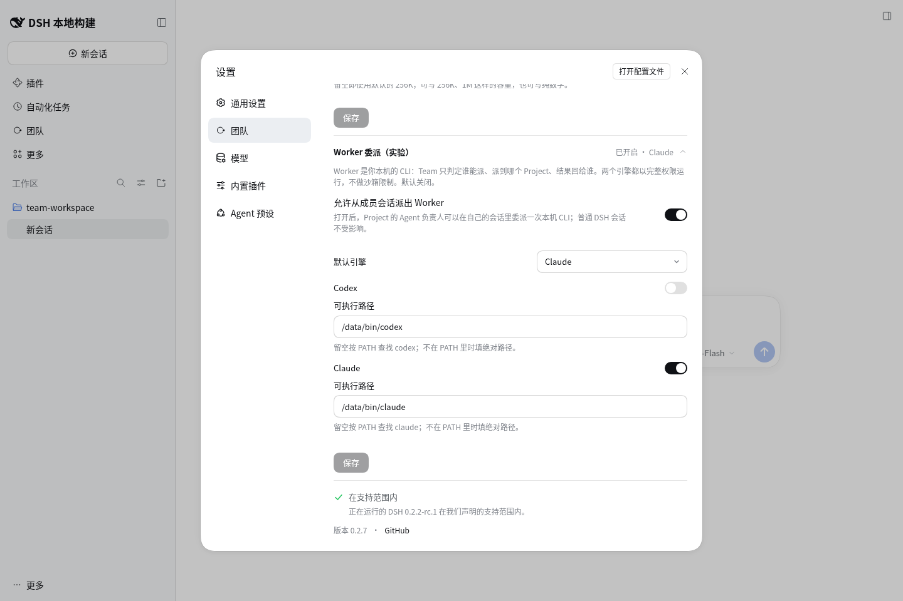

# 验收证据

## 06 — Claude 设置

2026-11-10，Reeve 人工查看 `2b22c59` 的浏览器产物后保留此图。它证明设置页的 Worker 实验开关已开、默认引擎为 Claude、Codex 关闭、Claude 开启且可执行路径为 `/data/bin/claude`；页面明确两个引擎按完整权限运行。窄屏与普通 DSH 恢复由完整浏览器旅程验证，不以这张桌面图替代。

复跑：`CHROME_PATH=/usr/bin/chromium npm run test:browser`。新图生成于 `artifacts/browser/ui-09/worker-settings-claude.png`（该目录为日常产物，不入版本库）。
